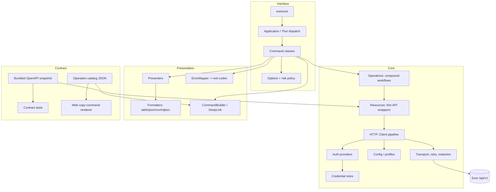

# Architecture Research

**Domain:** First-party Ruby CLI for a self-hosted Rails finance API
**Researched:** 2026-10-31
**Confidence:** HIGH for repo/API facts; MEDIUM for version-negotiation recommendations

## Standard Architecture

### System Overview



Layers: **interface** (argv, prompts, exit codes), **core** (one request pipeline, resources, operations), **presentation** (presenters, formatters, links), **contract** (OpenAPI snapshot, catalog, tests). No layer reaches upward; formatters never call HTTP.

### Component Responsibilities

| Component | Responsibility | Typical Implementation |
|-----------|----------------|------------------------|
| `Application` / dispatch | Root command, global flags, help, completion, version | Thor subclass, `exit_on_failure? false`, rescue to `ErrorMapper` |
| `Command` base | Fixed lifecycle: parse → guard → perform → render → map errors | Template method, ≤40 lines per command |
| `Options` + `RiskPolicy` | Typed flags, TTY/pipe rules, `--dry-run`, `--yes`, confirmation | POROs over Thor options; no prompts when `!stdin.tty?` |
| `Config` / `ProfileResolver` | Profiles, precedence, XDG paths, non-secret settings | YAML at `~/.config/sure/config.yml` (0600, dir 0700) |
| `Auth` + `CredentialStore` | API key and OAuth credentials, refresh, keychain/fallback | Keychain adapter; file fallback with warning; env for CI |
| `HTTP::Client` | One request/response pipeline for every command | `Net::HTTP` behind a small adapter; JSON encode/decode, timeouts, proxy |
| `RetryPolicy` | Idempotent retries, 429/`Retry-After`, jitter, cap | Only GET/HEAD/PUT/DELETE or POST with idempotency key |
| `Resources::*` | Paths, params, envelopes, pagination for one API group | `list/get/create/update/delete` + domain affordances (`#split`) |
| `Operations::*` | Multi-step workflows: import upload, export wait, OAuth | Only for compound flows; not a generic service layer |
| `Presenters` | Stable columns/fields per entity; no financial math | POROs returning ordered key/value rows |
| `Formatters` | Table/JSON/CSV/NDJSON; TTY auto-selection; stderr errors | Shared `Formatter` interface; JSON envelope `{data,meta}` |
| `Errors` / `ErrorMapper` | Map HTTP + API `error` strings to typed errors and exit codes | Leaf module used everywhere; includes `request_id` |
| `Links` / `Catalog` | Copyable command and `sure://` link generation | Static operation catalog; `Shellwords`; no execution |
| `Update::Checker` | Non-blocking gem update notice | 24h cache, 300ms timeout, TTY-only, opt-out env |
| Test harness | Unit, contract, stub-server, live smoke, golden output | Minitest + WebMock/VCR + Rack stub + Compose live job |

## Recommended Project Structure

```
cli/
├── sure.gemspec              # independent gem, AGPLv3, ruby >= 3.4
├── Gemfile / Gemfile.lock    # isolated from Rails bundle
├── Rakefile                  # test, lint, contract, catalog, release
├── README.md / CHANGELOG.md
├── exe/sure                  # gem executable; bin/sure for dev
├── lib/
│   ├── sure.rb               # public entry; no Rails requires
│   └── sure/
│       ├── version.rb
│       ├── cli/application.rb
│       ├── cli/command.rb            # base lifecycle
│       ├── cli/options.rb
│       ├── cli/commands/             # one file per command group
│       │   ├── auth.rb  accounts.rb  transactions.rb  imports.rb …
│       ├── config.rb  config/profile.rb  config/loader.rb
│       ├── auth/credential.rb  auth/store.rb  auth/keychain_store.rb
│       ├── auth/file_store.rb  auth/api_key.rb  auth/oauth.rb
│       ├── http/client.rb  http/request.rb  http/response.rb
│       ├── http/transport.rb  http/retry_policy.rb  http/redactor.rb
│       ├── resources/base.rb  resources/accounts.rb  resources/transactions.rb …
│       ├── resources/envelope.rb     # accounts/pagination vs data/meta
│       ├── operations/import_upload.rb  operations/export_download.rb
│       ├── output/formatter.rb  output/table.rb  output/json.rb
│       ├── output/csv.rb  output/ndjson.rb  output/selector.rb
│       ├── presenters/  errors/{mapper,exit_codes}.rb  links/{catalog,command_builder,deep_link}.rb  update/checker.rb
├── config/
│   ├── operations.yml        # source of truth for catalog
│   └── openapi.snapshot.yaml # pinned /api/v1 contract per release
├── dist/command_catalog.json # generated, checked in, vendored by web
├── test/
│   ├── unit/  commands/  resources/  contract/  integration/  live/
│   ├── fixtures/openapi/     # current + previous-minor snapshots
│   └── support/stub_server.rb  support/fake_store.rb
└── .github/workflows/cli.yml # or root workflow with cli/** paths
```

### Structure Rationale

- **`lib/sure/` not `lib/sure/cli/` for core:** `Sure::CLI` is only the interface layer, so resources/HTTP can be reused by future clients.
- **Commands per resource, not per endpoint:** CRUD verbs share one presenter and one resource; this keeps 110 operations navigable.
- **`config/operations.yml` + pinned OpenAPI:** one catalog drives help, copy commands, completion, and web; snapshots make releases offline-reproducible.

## Architectural Patterns

### Pattern 1: Thin command, one pipeline

**What:** A command only maps argv to a params hash, applies risk policy, calls one resource/operation, and renders one result. Every HTTP concern lives in `HTTP::Client`.
**When to use:** Always; this is the core constraint.
**Trade-offs:** Slight indirection for trivial commands, but consistent auth, retry, errors, and output across 100+ operations.

```ruby
class Commands::Transactions::List < Command
  desc "list", "List transactions"
  option :account, type: :string
  option :from, type: :string
  def perform
    resources.transactions.list(account_id: options[:account], from: options[:from])
  end
  def presenter = Presenters::Transaction
end
```

### Pattern 2: Resource + envelope adapter

**What:** One class per API group owns paths and response normalization; an `Envelope` adapter hides the two collection shapes (`{accounts,pagination}` and `{data,meta}`).
**When/Trade-offs:** Every endpoint; more files than a generic `Client#get`, but no envelope assumptions leak into commands and contract tests stay precise.

### Pattern 3: Declarative operation catalog

**What:** `config/operations.yml` lists argv template, typed params, web path, risk, and API method/path; a rake task compiles `dist/command_catalog.json`.
**When/Trade-offs:** Copy-command UI, completions, docs, coverage; generated artifact needs a drift check, but Rails never hand-maps commands.

### Pattern 4: Capability-gated compatibility

**What:** The CLI pins a contract and probes capabilities; unsupported operations return an upgrade message, not a raw 404.
**When/Trade-offs:** Read-only and optional endpoints, previous-minor servers; extra probe/cache logic in exchange for clear failure modes.

### Key Interfaces

```ruby
# HTTP
Client#request(verb, path, query: {}, body: nil, idempotency_key: nil, stream: false) -> Response
Response#status #headers #body #request_id #rate_limit #body_stream
RetryPolicy#call(attempt, response:, exception:) -> :retry | :raise

# Config / auth
Config.load(path: nil, env: ENV) -> Config
Config#profile(name = nil) -> Profile  # server_url, auth, timeout, tls_verify
CredentialStore#read(profile) -> Credential?; #write(profile, cred); #delete(profile)
Auth::Provider#header -> Hash  # API key or OAuth; refresh under a file lock
Auth::Loopback#authorize(server:, scopes:) -> Credential

# Resources / pagination
Resources::Base#list(query = {}) -> Collection; #get(id) -> Entity
Resources::Base#create(attrs, idempotency_key: nil) -> Entity
Collection#records #meta #each_page(limit: 100) { |page| }

# Presentation / errors
Formatter#render(value, presenter:, schema: nil, io: $stdout)
ErrorMapper#map(response_or_exception) -> Errors::Error; Errors::Error#exit_code #details #request_id

# Links / catalog
Catalog.load(path) -> Catalog; Catalog#operation(id) -> Operation
CommandBuilder#build(operation_id, params, shell: :posix) -> String
DeepLink#build(server_url, web_path, query: {}) -> String
```

## Data Flow

### Read

```
argv → Thor → Options → Command → Resources#list → HTTP::Client
  → profile URL → auth → transport → decode → Envelope/Paginator
  → Collection → Presenter → Formatter → stdout
  ↘ ErrorMapper → stderr + exit code
```

### Write

```
argv → Command → RiskPolicy (dry-run prints the plan; else confirm) → Resources#create/update/delete
  → Client → 2xx → Entity → Presenter → Formatter
  ↘ 401/403/404/409/422/429/5xx → typed error → stderr + exit code
```

### Async

```
POST (201/202) → id → poll GET with backoff/Retry-After → completed → render
  ↘ failed → typed error + request_id;  --no-wait → id + follow-up command
```

Applies to `import_sessions` (create → chunks → publish → poll), `family_exports` (create → poll → download; 409 means not ready), and chat messages (201 user message; assistant completes via background job, so poll the chat).

### Streaming

```
Client#request(stream: true) → Transport yields chunks
  → Sink: atomic file | NDJSON lines | future SSE
  → progress to stderr; uploads use ≤10MB chunks + sequence/client_chunk_id
```

Today the API has no SSE/WebSocket for chats; design `Response#body_stream` and an `Events` seam so a future streaming endpoint does not change commands. Tables are never streamed; NDJSON output may be.

**State:** config (non-secret), credential store (secret), 24h cache (update/capability probe), and request context; no local financial cache, so every read reflects the server.

## Output and Error Contract

- Selection: `--json`, `--csv`, `--ndjson`, `--output table|json|csv`, `--quiet`; explicit flag wins, otherwise table on TTY and JSON on pipe.
- JSON envelope: `{"data": ..., "meta": {...}}`; errors on stderr: `{"error","message","details","request_id"}`.
- Money is a decimal string; never parse to `Float`, never recompute balances, cash flow, budgets, or classifications.
- Exit codes: `0` success, `2` usage/confirmation, `3` config, `4` auth/scope, `5` not found, `6` validation, `7` conflict, `8` rate limit, `9` network/server, `10` contract/unsupported, `130` interrupted.
- Redaction is centralized: never log `X-Api-Key`, `Authorization`, refresh tokens, or full bodies at default verbosity.

## Compatibility and Contract Tests

- `config/openapi.snapshot.yaml` is pinned per CLI release; `sure version --json` reports CLI version, contract hash, profile, and capabilities. No server-version endpoint exists today: recommend `GET /api/v1/meta` (version, api_version, features) or an `X-Sure-Version` header; until then probe and cache capabilities for 24h.
- Catalog coverage test: every operation path/method exists in the snapshot; every command has help, example, risk, and representable required params.
- Fixture test: recorded/stubbed responses validate against schemas (types, required, enums), tolerating unknown fields; require only fields the presenter uses and surface `ContractError` with `request_id` when one disappears.
- Drift/matrix: CI compares root `docs/api/openapi.yaml` to the snapshot and fails until `rake contract:update` is reviewed; contract + integration cover current and previous-minor snapshots, with live smoke on both before release.
- **Known contract gaps (2026-10-31):** OpenAPI exposes reads only for accounts, budgets, holdings, rules, transfers, and syncs; no sync trigger; categories lack update/delete. Features depending on these need server endpoints first — do not fake them client-side.

## Web Platform: Copyable Commands and Deep Links

- Rails reads a **pinned JSON artifact** (`cli/dist/command_catalog.json`), not the gem at runtime; templates are static, typed (UUID/date/enum), and shell-escaped with stdlib `Shellwords`. `--api-key` is never a template parameter.
- A ViewComponent/helper renders `<code>` plus a clipboard button; deep links render `sure://{host}[:port]/{web_path}` (existing desktop scheme) with an HTTPS fallback.
- The server never calls `system`, `Open3`, `eval`, or the CLI binary. The catalog is data; output is escaped text or an outbound link. A future `sure://command/...` needs an installed local handler and explicit user action.

## Build Order and Dependency Direction

```
commands → operations → resources → http → auth/config
    ├→ output/presenters
    ├→ links/catalog
    └→ errors (leaf, used by all)
contract/openapi → resources + tests (test-time, no runtime cycle)
```

1. Gem skeleton, isolated bundle, CI path filter, release tag; config/profiles + credential store + redaction.
2. HTTP pipeline + pinned OpenAPI contract loader + catalog skeleton.
3. Read vertical slice: `accounts`, `transactions`, `cash_flow`, `budgets`; table/JSON/CSV.
4. Copy-command catalog + web rendering.
5. Writes: transactions, tags, merchants, categories; dry-run, confirm, idempotency.
6. Async: imports, exports, chats; streaming/resumability.
7. OAuth loopback + PKCE + refresh; remaining reads, completion, update check, live CI.

## Monorepo, Release, and CI Boundaries

- **Gem:** separate `sure.gemspec`, `Gemfile`, lockfile, tests, and `cli/CHANGELOG.md`; independent semver and tag `cli-vX.Y.Z`.
- **Rails/CI:** no new runtime dependency; a path-filtered workflow on `cli/**` and `docs/api/openapi.yaml` runs lint, unit, contract, stub integration, package, live smoke, and release. `docs/api/openapi.yaml` stays authoritative.
- **Release/live:** RubyGems trusted publish, container image, optional Homebrew dispatch, contract hash in notes; live job uses Compose Sure + Postgres + Redis with seeded read/read_write keys.

## Trade-offs

| Decision | Benefit | Cost / Mitigation |
|----------|---------|-------------------|
| Thor | Mature help/completion, familiar | CLI-ish exit semantics; subclass and map errors |
| Keychain-first, file fallback | Secure default, headless works | Fallback must warn and be 0600; CI uses env |

## Scaling Considerations

| Scale (API surface) | Architecture adjustment |
|---------------------|-------------------------|
| 0–20 commands | One file per domain; catalog generation unnecessary. |
| 20–60 commands | Resource modules + presenters; introduce catalog and contract tests. |
| 60–110+ | Generated docs/completion and coverage gates; first bottlenecks are contract drift, auth-refresh races, then large exports (stream, never buffer). |

## Anti-Patterns

1. **Fat commands** doing HTTP, formatting, and prompts inline. → Command lifecycle + resource + presenter.
2. **Recomputing money or reports client-side.** → Render server values; decimal strings only.
3. **API keys in `config.yml`, argv, or logs.** → Keychain/stdin/env; redacting logger; never `--api-key`.
4. **Assuming one response envelope or auto-paginating into memory.** → Envelope adapter; page iterator + `--all`, stream NDJSON.
5. **Executing CLI commands from Rails.** → Catalog templates and escaped links only.

## Integration Points

| Boundary | Communication | Notes |
|----------|---------------|-------|
| CLI ↔ Sure API | HTTPS `/api/v1` | API key or OAuth bearer; `read`/`read_write`; honor rate-limit headers |
| CLI ↔ browser / keychain | Loopback PKCE; `security`/`secret-tool`/Credential Manager | Stable `device_id`; inject fake store in tests |
| CLI ↔ web / desktop | Generated JSON artifact; `sure://{host}/{path}` | Pinned checksum; links are navigation only, never credentials |

## Sources

- `docs/api/openapi.yaml`, `app/controllers/api/v1/base_controller.rb`, `app/models/api_key.rb`
- `docs/llm-guides/architecture.md`, `docs/clients.md`, `desktop/README.md`; Thor/dry-cli, RubyGems, keychain docs

---
*Architecture research for: Sure CLI*
*Researched: 2026-10-31*
